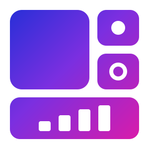
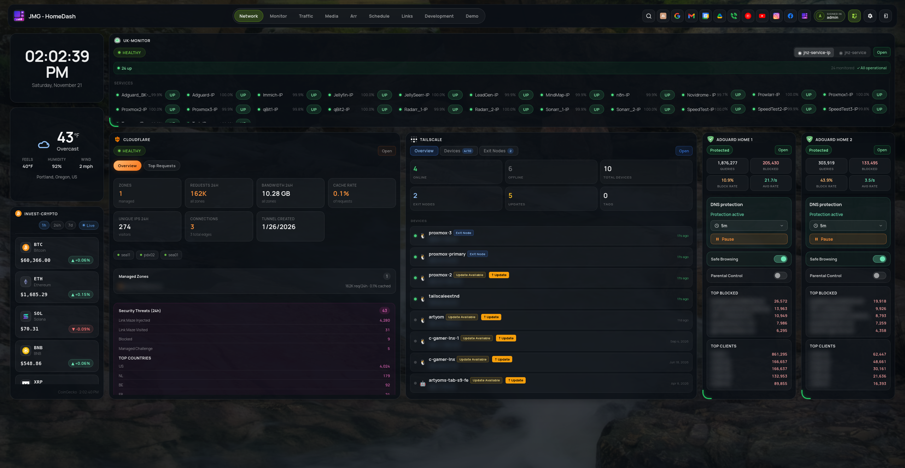
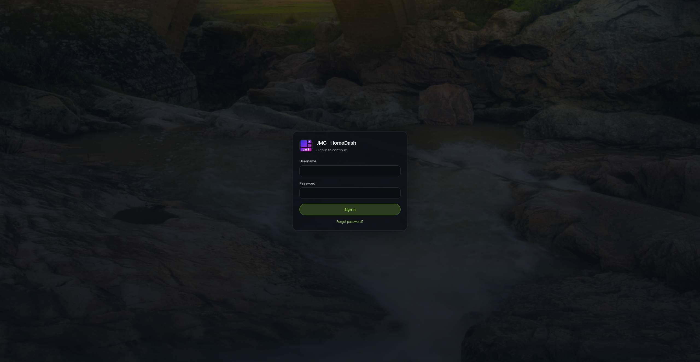
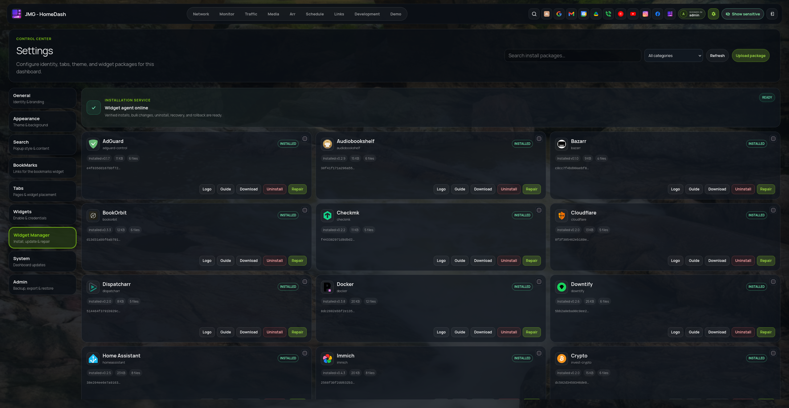
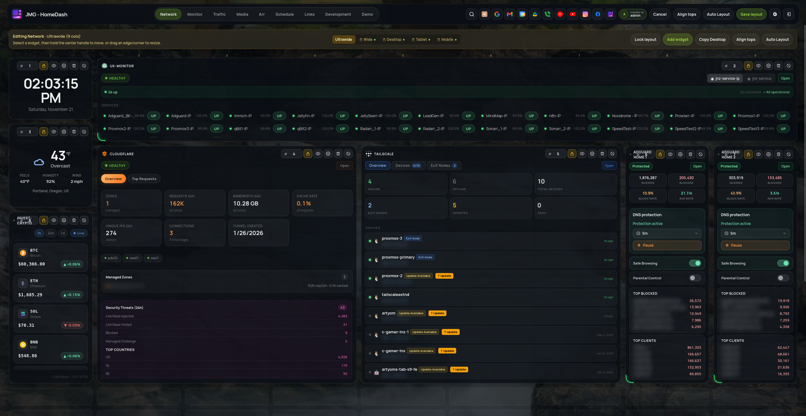
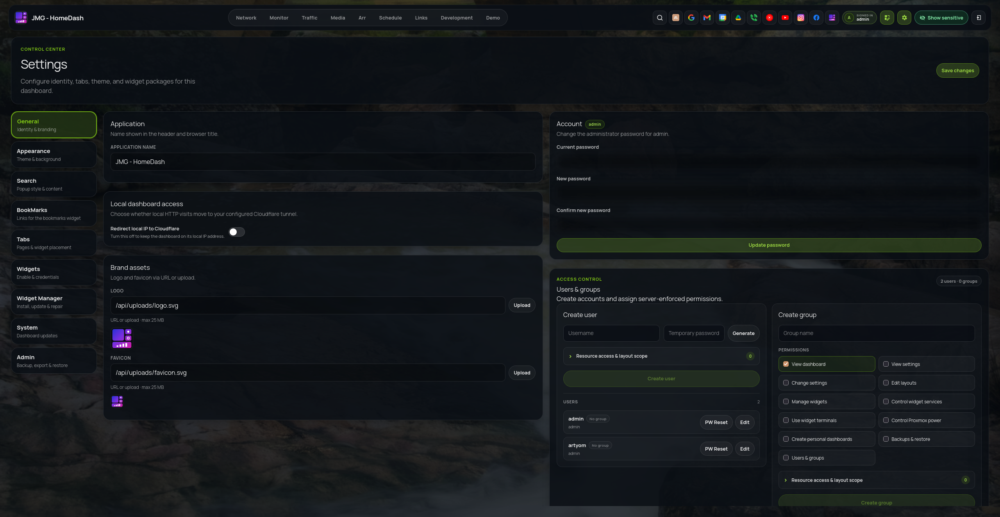

  

<h1 align="center">HomeDash</h1>

  <b>A modern, easy-to-use, multi-platform dashboard for monitoring and controlling your home lab and devices.</b> 
  Live widgets, per-device layouts, multi-user access control, and one-click updates. Run it on Proxmox or Docker, and control it from Windows, Linux or Android.

  
  
  
  
  
  
  
    

  

---

## Why HomeDash?

Most home lab setups end up as a pile of browser tabs: one for DNS, one for your tunnel, one for the media stack, one for monitoring. HomeDash pulls all of it onto a single, fast, good-looking dashboard, and lets you act on things, not just look at them.

- **See everything at a glance.** Uptime, DNS stats, VPN nodes, downloads, weather, and more, live on one screen.
- **Control, don't just monitor.** Pause DNS protection, toggle Safe Browsing, manage users, and trigger maintenance jobs straight from the widgets.
- **Make it yours.** Drag-and-drop layouts, tabbed pages, custom themes and backgrounds, your own branding.
- **Extend it.** Widgets ship as installable `.hdwidget` packages, so adding a service doesn't mean rebuilding the app.
- **Run it your way.** Install the host on Proxmox or Docker, then connect from any device with a controller app.

## How it works

HomeDash has two parts:

| Part | What it does | Where it runs |
|---|---|---|
| **HomeDash Host** | The dashboard server. It serves the web UI, stores your layouts, users and widget configs, and runs the widget agent for installs, updates and maintenance jobs. | Proxmox LXC **or** an existing Docker host |
| **Controller apps** | Native apps that connect to your host and give you the dashboard as a dedicated app on your devices. | Windows, Linux (Ubuntu), Android |

You install **one host**, then as many **controller apps** as you like. The dashboard is also reachable from any modern browser.

📖 **New to HomeDash?** Start with the [Quick Start](userguide.md#quick-start), or read the full [User Guide](userguide.md).

## Installation

### Step 1: Install the HomeDash Host

Pick whichever fits your setup. Each option has its own step-by-step guide.

| Option | Best for | Guide |
|---|---|---|
| **Proxmox (LXC container)** | Proxmox users. Runs the host in its own LXC container and enables the host-level features (system updates, cleanup tool) out of the box. | [Proxmox install guide](HomeDash%20installers/Proxmox/PVE-INSTALL-README.md) |
| **Existing Docker host** | Anyone already running Docker, or without Proxmox. Runs HomeDash alongside your other containers. | [Docker install guide](HomeDash%20installers/Docker/homedash-docker-install.md) |

Once the host is running, open it in your browser and sign in with the admin account.

> **First login:** sign in with the admin password you set during installation. You can change it any time under **Settings → General → Account**.

  

### Step 2: Install a Controller app (optional)

Download the controller for your device from the [Releases](../../releases) page.

| Platform | Package | Notes |
|---|---|---|
| **Windows** | `.exe` installer | Installs the app controller (`JMG - HomeDash`) |
| **Linux (Ubuntu)** | `.deb` package | Install with `sudo apt install ./HomeDash-Controller-<version>-amd64.deb` |
| **Android** | `.apk` | Enable "install unknown apps" for your browser or file manager, then open the file |

On first launch, enter your HomeDash host address and sign in.

## Installing Widgets

Widgets are managed from inside the dashboard, so you never need to touch the host's command line.

1. Sign in as an admin and open **Settings → Widget Manager**.
2. Find the widget you want in the list.
3. Click **Install**. A live log shows the install and rebuild as it runs.
4. When it finishes, enable the widget under **Settings → Widgets**, enter its credentials (URL, API key, etc.), then add it to a tab from **Settings → Tabs** or Edit Layout mode.

New and updated widgets are published as `.hdwidget` packages on this GitHub repo. When a new version is available, it shows up in the Widget Manager and you can update it the same way, with the **Install** button.

<!-- TODO: confirm how the Widget Manager finds new packages (auto-listed from GitHub vs. manual .hdwidget upload) and adjust the paragraph above if needed -->

> Only the **Admin** account can install widgets, and widgets in sensitive categories (Security, Credentials, Networking) are admin-only by default.

  

## Features

### Dashboard
- **Tabbed pages** (Network, Monitor, Media, Arr, and whatever else you want) with widget placement per tab
- **Edit Layout mode** with drag-and-resize cards
- **Per-device layouts.** Each breakpoint keeps its own layout, and widgets can be hidden on specific devices. Hidden cards automatically drop below the visible ones, so there are no gaps.
- **Global search** popup and a **bookmarks** widget for your quick links
- **Themes and backgrounds** with a glass-morphism design system
- **Custom branding.** Set the app name, logo and favicon from the UI.

  

### Widgets
Widgets are installed and updated through the built-in **Widget Manager**. Current widgets include:

| Category | Widgets |
|---|---|
| **Network & DNS** | AdGuard Home (multi-instance), Cloudflare, Tailscale |
| **Monitoring** | UK-Monitor (Uptime Kuma), Home Assistant devices |
| **Media & Arr** | Radarr, Sonarr, Prowlarr, Jellyfin Slider, qBittorrent |
| **Security** | Vaultwarden |
| **Everyday** | Clock, Weather, Crypto prices, Bookmarks |
| **AI** | AI Chat (Gemini, Claude, ChatGPT, Perplexity) |

### Administration
- **Users & groups** with server-enforced permissions: view dashboard, view/change settings, edit layouts, manage widgets, control widget services, use widget terminals, create personal dashboards, backups, and user management
- **Per-widget access control.** Sensitive categories (Security, Credentials, Networking) are admin-only by default.
- **Widget Manager:** install, update and repair widget packages with live log streaming
- **System updates:** apply dashboard updates (`.hdupdate` packages) from the UI
- **Cleanup tool:** one click prunes Docker build cache, images and volumes, cleans apt and vacuums journal logs, with an optional **recurring schedule**
- **Config backup & restore** from Settings → Admin
- **Cloudflare tunnel awareness:** optionally redirect local-IP visits to your configured tunnel

  

## Updating

- **Host:** from **Settings → System**, upload a `.hdupdate` package and watch the log stream live. Proxmox users can alternatively re-run the update bundle against the existing LXC (see the [Proxmox install guide](HomeDash%20installers/Proxmox/PVE-INSTALL-README.md)).
- **Widgets:** from **Settings → Widget Manager**, click **Install** on any widget with a newer version. Updated `.hdwidget` packages are published on this GitHub repo as they become available. See [Installing Widgets](#installing-widgets).
- **Controller apps:** download the newer installer from [Releases](../../releases) and install over the top.

## Building a Widget

Widgets are self-contained `.hdwidget` packages. Each one bundles:

- a `manifest.ts` describing the widget, its version and its config fields (URLs, API keys, etc.)
- a React `Widget.tsx` UI
- optional API routes and styles
- an `install.sh` that registers the widget and rebuilds the app

<!-- TODO: link to docs/widgets.md once written -->

## Tech Stack

- **Host / web UI:** Next.js, React, TypeScript
- **Host agent:** Python daemon for privileged jobs (installs, updates, cleanup, schedules)
- **Deployment:** Proxmox LXC or Docker Compose
- **Controller apps:** Windows (.exe), Ubuntu (.deb), Android (.apk)

## Roadmap

<!-- TODO: fill in or delete -->
- [ ] More widgets
- [ ] Widget developer docs
- [ ] Additional controller platforms

## Community

Questions, ideas or a dashboard to show off? Join the **[HomeDash Discord](https://discord.gg/7xp7ZZu7f)**

- **#support** for help with installing or using HomeDash
- **#showcase** to share your setup
- **#feature-requests** to suggest widgets and features
- **#announcements** for new releases

Confirmed bugs belong in [GitHub Issues](https://github.com/SecuredNodeDynamics/Homedash/issues).

## Contributing

Issues and pull requests are welcome. If you're building a widget, open an issue first so we can keep the package format consistent.

## License

Distributed under the **MIT License**. See [`LICENSE`](LICENSE) for details.

---

  Built by <b>Janzen Media Group</b>

