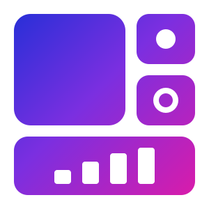
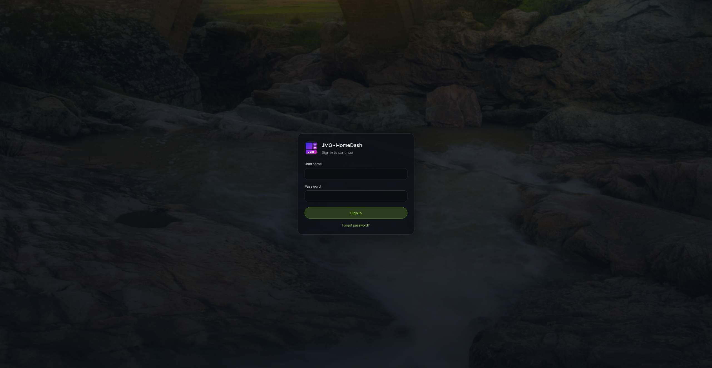
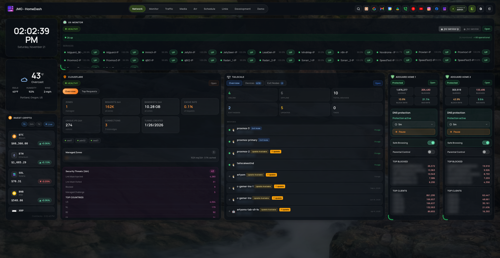
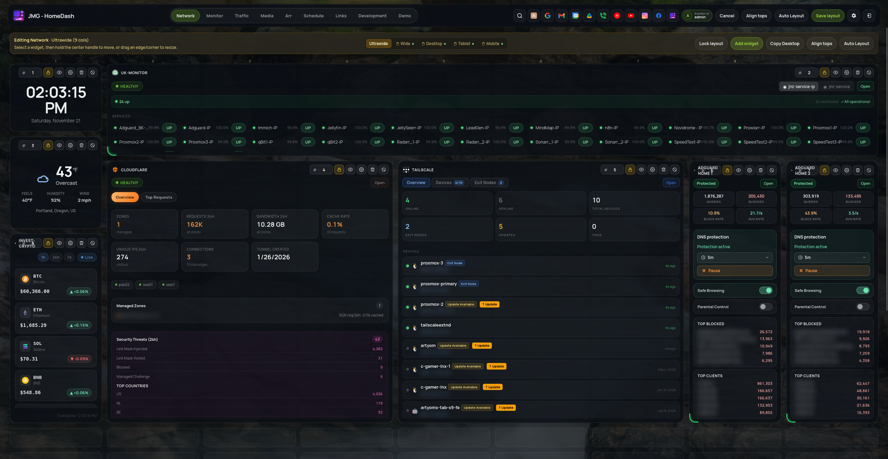
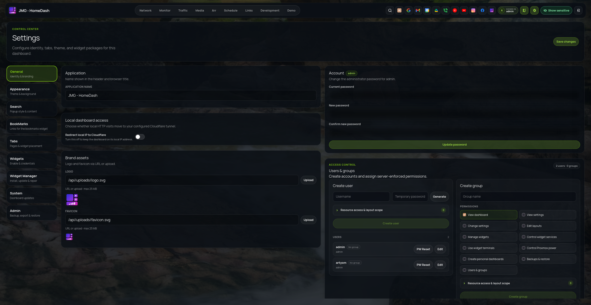
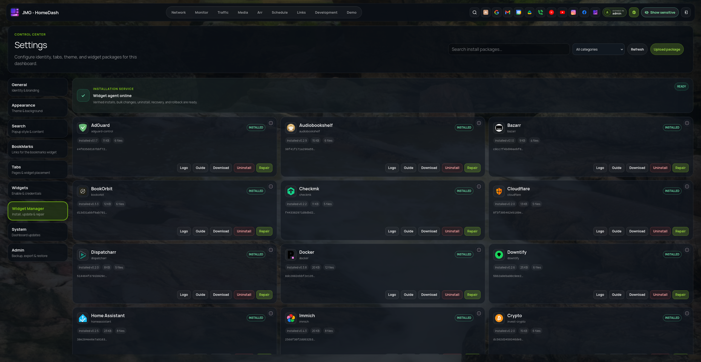

  

<h1 align="center">HomeDash User Guide</h1>

  Everything you need to set up, customize and manage your HomeDash dashboard.

---

## Table of Contents

**[Quick Start](#quick-start)** (set up in about 15 minutes)

1. [Introduction](#1-introduction)
2. [Getting Started](#2-getting-started)
3. [Finding Your Way Around](#3-finding-your-way-around)
4. [Working With Widgets](#4-working-with-widgets)
5. [Built-in Widget Reference](#5-built-in-widget-reference)
6. [Customizing Your Layout](#6-customizing-your-layout)
7. [Settings Reference](#7-settings-reference)
8. [Installing and Updating Widgets](#8-installing-and-updating-widgets)
9. [Users, Groups and Permissions](#9-users-groups-and-permissions)
10. [Maintenance: Updates, Cleanup and Backups](#10-maintenance-updates-cleanup-and-backups)
11. [Controller Apps](#11-controller-apps)
12. [Security Best Practices](#12-security-best-practices)
13. [Troubleshooting](#13-troubleshooting)
14. [Glossary](#14-glossary)

---

## Quick Start

New to HomeDash? This is the shortest path from nothing to a working dashboard. Each step links to the full details.

### Step 1: Install the Host

The Host is the HomeDash server. Pick one:

| If you have... | Use | Time |
|---|---|---|
| A **Proxmox** server | [Proxmox install guide](HomeDash%20installers/Proxmox/PVE-INSTALL-README.md). It creates the container, installs Docker and builds HomeDash for you. | About 10 minutes |
| A Linux server with **Docker** | [Docker install guide](HomeDash%20installers/Docker/homedash-docker-install.md) | About 10 minutes |

Both builds compile HomeDash on first run, so the first install takes a few minutes.

### Step 2: Create your admin account

- **Proxmox:** the installer asks for your admin username and password during setup.
- **Docker:** open `http://SERVER_IP:3080/setup` and choose your admin username and password.

There is no preset password. After that, open `http://SERVER_IP:3080` (use your container's IP for Proxmox) and sign in.

### Step 3: Install your widgets

A fresh dashboard starts with **Clock, Weather, Notes, Todo, Grocery List and Bookmarks**. To add more:

1. Open **Settings → Widget Manager**.
2. Click **Install** on each widget you want and wait for the log to finish.
3. Open **Settings → Widgets**, enable each widget, and enter its URL and API key or login.

### Step 4: Arrange your dashboard

1. Open **Settings → Tabs** to create the pages you want, such as *Network* and *Media*.
2. Go back to the dashboard and enter **Edit Layout** mode to drag and resize your widgets.
3. Save when you're happy with it.

> **Each device type has its own layout.** You can customize the dashboard separately for **desktop, laptop, tablet and phone**. On a tablet or phone you can set up both the **landscape** and **portrait** layouts. HomeDash switches to the layout you configured automatically, depending on the device and how it is held.
>
> You can also **lock the layout**, **lock widget sizes**, and **show or hide** individual widgets. See [Customizing Your Layout](#6-customizing-your-layout).

### Step 5: Make it yours (optional)

- **Settings → General:** set the application name, logo and favicon.
- **Settings → Appearance:** choose a theme and background.
- **Settings → BookMarks:** add the quick-link icons in the header. The icon picker comes with a library of 3,942 icons.

### Step 6: Get the controller app (optional)

Download the app for your device from the [Releases](https://github.com/SecuredNodeDynamics/Homedash/releases) page: `.exe` for Windows, `.deb` for Ubuntu or `.apk` for Android. Launch it, enter your host address and sign in.

### Step 7: Add other users (optional)

Open **Settings → General → Access control** to create accounts. Give people only the permissions they need. See [Users, Groups and Permissions](#9-users-groups-and-permissions).

### You're done. Where next?

| I want to... | Go to |
|---|---|
| Understand the interface | [Finding Your Way Around](#3-finding-your-way-around) |
| Set up a specific widget | [Built-in Widget Reference](#5-built-in-widget-reference) |
| Change layouts or hide widgets on a phone | [Customizing Your Layout](#6-customizing-your-layout) |
| Update HomeDash or free up disk space | [Maintenance](#10-maintenance-updates-cleanup-and-backups) |
| Fix something | [Troubleshooting](#13-troubleshooting) |

---

## 1. Introduction

HomeDash is a dashboard for monitoring and controlling your home lab and devices. It brings the tools you use every day (DNS filtering, uptime monitoring, VPN, media automation, downloads, password vault and more) onto one customizable screen, so you can see what's happening and act on it without juggling browser tabs.

### Key concepts

| Term | What it means |
|---|---|
| **Host** | The HomeDash server. It runs on a Proxmox LXC container or an existing Docker host, serves the dashboard, and stores your layouts, users and settings. |
| **Controller app** | A native app (Windows, Ubuntu or Android) that connects to your host. You can also use any web browser. |
| **Tab (page)** | A page of the dashboard, such as *Network*, *Monitor* or *Media*. Each tab holds its own set of widgets. |
| **Widget** | A card on a tab that shows live information from a service and often lets you control it. |
| **Widget package** | A `.hdwidget` file that adds a widget to HomeDash. Installed from the Widget Manager. |
| **Layout** | The size and position of the widgets on a tab. Each screen size keeps its own layout. |

> This guide covers day-to-day use. To install the host itself, see the [Proxmox install guide](HomeDash%20installers/Proxmox/PVE-INSTALL-README.md) or the [Docker install guide](HomeDash%20installers/Docker/homedash-docker-install.md).

---

## 2. Getting Started

### 2.1 Open HomeDash

Open the address of your host in a browser, or launch a [controller app](#11-controller-apps) and enter your host address.

  

### 2.2 Sign in

Sign in with the **admin** account and the password you chose during installation. HomeDash has no preset password.

To change your password later:

1. Open **Settings → General** and find the **Account** card.
2. Enter your current password, then the new password twice, and click **Update password**.

> Use a strong, unique password, especially if your dashboard is reachable from outside your network.

### 2.3 Your first five minutes

1. **Name it.** Settings → General → Application name.
2. **Brand it.** Upload your logo and favicon under **Brand assets**.
3. **Install widgets.** Settings → Widget Manager → click **Install** on the services you run (see [Section 8](#8-installing-and-updating-widgets)).
4. **Configure widgets.** Settings → Widgets → enable each widget and enter its URL and credentials.
5. **Arrange the dashboard.** Use Edit Layout mode ([Section 6](#6-customizing-your-layout)).

---

## 3. Finding Your Way Around

  

### The header

| Area | What it does |
|---|---|
| **Logo and name** (left) | Shows your application name and logo. Both are configurable. |
| **Tabs** (center) | Switch between dashboard pages. Your tabs are whatever you create in Settings → Tabs. |
| **Search** | Opens the search popup. Its style and content are set in Settings → Search. |
| **Quick links** | Row of icon shortcuts to your favorite sites, set in Settings → BookMarks. |
| **Signed-in badge** | Shows which account you are using. |
| **Settings (gear)** | Opens the Control Center. Visible only if your account has permission. |
| **Sign out** | Ends your session. |

### Working with tabs

Click a tab name to switch pages. Each tab remembers its own widgets and layout. You can create, rename, reorder and remove tabs, and decide which widgets appear on each, under **Settings → Tabs**.

### The Settings page

Settings (the *Control Center*) has a menu on the left covering General, Appearance, Search, BookMarks, Tabs, Widgets, Widget Manager, System and Admin. See [Section 7](#7-settings-reference). On some pages a **Show sensitive** button appears in the header to reveal values that are hidden by default.

---

## 4. Working With Widgets

Widgets are the heart of HomeDash. Most follow the same conventions.

### Common elements

- **Status badge.** Many widgets show a small badge such as *Healthy* or *Protected* so you can tell at a glance whether a service is OK.
- **Open button.** Opens the underlying service's own web interface in a new tab.
- **Inner tabs.** Larger widgets split their content into tabs, for example *Overview* and *Top Requests*, or *Devices* and *Exit Nodes*.
- **Live refresh.** Widgets poll their service automatically, so numbers update without reloading the page. Where a widget shows a "last updated" time, you will see it in the footer.
- **Action buttons and toggles.** Widgets that can control a service, such as pausing DNS protection or updating a device, show clearly labeled buttons or switches.

### Adding a widget to a tab

1. Make sure the widget is installed (Settings → Widget Manager).
2. Enable it and enter its connection details (Settings → Widgets).
3. Place it on a tab (Settings → Tabs, or Edit Layout mode on the dashboard).

### Who can see what

Each widget has an access setting that controls which users can see and use it. Widgets in the **Security**, **Credentials** and **Networking** categories are **not** available to standard users by default. Only the Admin sees them.

---

## 5. Built-in Widget Reference

Each widget needs its service's address (and usually an API key or login) under **Settings → Widgets**.

### Network and DNS

#### AdGuard Home
Shows DNS protection stats for an AdGuard Home server. You can add more than one instance (for example *AdGuard Home 1* and *2*) and place them side by side.

- **Stats:** total queries, blocked queries, block rate and average processing rate
- **DNS protection:** shows whether protection is active, with a duration selector and a **Pause** button to disable filtering temporarily
- **Safe Browsing** and **Parental Control** toggles
- **Top Blocked** and **Top Clients** lists

#### Cloudflare
Shows the health of your Cloudflare account.

- **Overview tab:** managed zones, requests (24h), bandwidth (24h), cache rate, unique IPs, tunnel connections and tunnel creation date, plus the managed zones list
- **Security threats (24h):** counts by type and top countries
- **Top Requests tab:** your busiest traffic

#### Tailscale
Shows your tailnet.

- **Overview:** online and offline device counts, total devices, exit nodes, pending updates and tags
- **Devices:** every device with its last-seen time, an *Update Available* badge, and an **Update** button where supported
- **Exit Nodes:** devices offering exit-node routing

### Monitoring

#### UK-Monitor (Uptime Kuma)
Shows the status of everything your Uptime Kuma instance watches.

- Overall status (for example *24 up, all operational*) and a per-service list with uptime percentage and an **UP/DOWN** badge
- **Click any service** to open a detail popup anchored just below the row. The popup refreshes with the widget's 60-second poll, so its stats stay live while it is open.
- Switch between multiple monitor instances using the selector at the top right

#### Home Assistant
Shows and controls your Home Assistant devices. Set the Home Assistant URL and a long-lived access token in Settings → Widgets.

### Media and Arr

#### Radarr, Sonarr and Prowlarr
Show your movie, TV and indexer activity. Each connects with the service URL and API key. You can run multiple instances (for example *Radarr_1* and *Radarr_2*).

#### Jellyfin Slider
A media carousel for your Jellyfin library, with download support.

- **Downloads** show real progress. An aggregate progress pill appears in the top-right of the widget toolbar while files are downloading.
- Large files are buffered before saving, so very large downloads need free memory in your browser.
- While a download is running, a notice reminds you that closing the app will interrupt it. Wait for the download to finish before closing.

#### qBittorrent
Shows and manages your torrents. Recent qBittorrent versions require an **API key** instead of a username and password:

1. In qBittorrent, open **Preferences → WebUI → API Key** and generate a key.
2. Paste it into the widget's **API Key** field in Settings → Widgets.

### Security

#### Vaultwarden
Administration for your Vaultwarden server. This widget is admin-only.

- **Status:** server health and configuration status
- **Users:** user list and actions
- **Config:** server settings
- **Orgs:** organizations and per-organization member management (reinvite, revoke, restore, remove). This tab needs your Vaultwarden **Personal API Key** client ID and secret in the widget settings.

Authentication to the admin area uses your Vaultwarden admin token.

### Everyday

| Widget | What it shows |
|---|---|
| **Clock** | Current time and date |
| **Weather** | Temperature, conditions, feels-like, humidity and wind for your location |
| **Crypto prices** | Live prices and percent change for your chosen coins, with 1h / 24h / 7d / Live ranges, sourced from CoinGecko |
| **Bookmarks** | Your saved links (managed under Settings → BookMarks) |

### AI

#### AI Chat
A chat panel for talking to AI assistants from your dashboard. You can configure any of these agents:

| Agent | Provider |
|---|---|
| **Gemini** | Google |
| **Claude** | Anthropic |
| **ChatGPT** | OpenAI |
| **Perplexity** | Perplexity AI |

To set it up, open **Settings → Widgets**, enable the AI Chat widget, and add the API key for each agent you want to use. You only need to configure the ones you plan to use.

---

## 6. Customizing Your Layout

  

### Entering Edit Layout mode

Use the layout editing control on the dashboard header (available to accounts with the **Edit layouts** permission). In this mode widgets can be moved and resized.

### Moving and resizing

- **Move** a card by dragging it to a new position.
- **Resize** a card by dragging its edge or corner. Cards can be narrower than the full page, so you can place several side by side.
- **Save** your changes when you are done. Your layouts are stored on the host, so they follow you across devices of the same type.

### Layouts per device type

HomeDash keeps a **separate layout for each device type**:

| Device | Layouts you can customize |
|---|---|
| **Desktop** | One layout |
| **Laptop** | One layout |
| **Tablet** | **Landscape** and **portrait** |
| **Phone** | **Landscape** and **portrait** |

HomeDash **switches automatically** to the layout you set for the device you are using. On a tablet or phone it also follows the orientation, so rotating the device loads the landscape or portrait layout. Arranging the dashboard on a large monitor never rearranges it on your phone.

To change a layout, view the dashboard on that device type (and in that orientation, for tablets and phones) and edit it there.

### Locking your layout and widget sizes

Once you are happy with an arrangement, you can protect it:

- **Lock the layout** to stop cards from being moved by accident.
- **Lock widget sizes** to stop cards from being resized, while still allowing other changes.

Unlock either one whenever you want to make changes.

### Showing and hiding widgets

Any widget can be shown or hidden on the device layout you are editing, which is useful for keeping a phone view compact.

- **Hide** a card in Edit Layout mode, and **show** it again whenever you want.
- Hidden cards **automatically move below all visible cards**, so hiding a widget never leaves a gap in your layout.
- The widget is not deleted, and stays visible on other device layouts unless you hide it there too.

### Tips

- Put the widgets you check most at the top-left of each tab.
- Group related widgets on one tab (for example all DNS widgets on *Network*).
- Use a dedicated *Demo* tab for screenshots so private widgets never appear in them.

---

## 7. Settings Reference

Open the gear icon in the header to reach **Settings**. Sections appear in a menu on the left.

### 7.1 General: identity and branding

  

| Card | What it does |
|---|---|
| **Application** | Sets the name shown in the header and the browser tab title. |
| **Local dashboard access** | The **Redirect local IP to Cloudflare** switch controls whether visits to the dashboard's local HTTP address are redirected to your configured Cloudflare tunnel. Turn it **off** to keep the dashboard on its local IP address. |
| **Brand assets** | Set your **logo** and **favicon**, either by entering a URL or clicking **Upload**. Maximum 25 MB. A preview appears below each field. |
| **Account** | Change the administrator password. |
| **Access control** | Create users and groups and assign permissions (see [Section 9](#9-users-groups-and-permissions)). |

Remember to click **Save changes** after editing.

### 7.2 Appearance: theme and background
Choose the look of your dashboard, including the theme and background image.

### 7.3 Search: popup style and content
Configure how the search popup looks and what it searches.

### 7.4 BookMarks
Manage the links shown in the header's quick-link row and in the Bookmarks widget. Add a name, address and icon for each.

### 7.5 Tabs: pages and widget placement
Create, rename, reorder and delete tabs, and choose which widgets live on each.

### 7.6 Widgets: enable and credentials
Turn installed widgets on or off, and enter each one's connection details (URL, API key, token or login). Also where per-widget access is controlled.

### 7.7 Widget Manager: install, update and repair
Install new widgets and update existing ones. See [Section 8](#8-installing-and-updating-widgets).

### 7.8 System: dashboard updates
Apply updates to HomeDash itself. See [Section 10](#10-maintenance-updates-cleanup-and-backups).

### 7.9 Admin: config backup & restore and cleanup
The **Config backup & restore** card, plus the **Cleanup** card with its schedule. See [Section 10](#10-maintenance-updates-cleanup-and-backups).

---

## 8. Installing and Updating Widgets

  

### Install a widget

1. Sign in as an admin and open **Settings → Widget Manager**.
2. Find the widget you want in the list.
3. Click **Install**.
4. Watch the live log. HomeDash installs the package and rebuilds the app. This can take a minute or two.
5. When it finishes, go to **Settings → Widgets**, enable the widget and enter its connection details.
6. Add it to a tab.

### Update a widget

New and updated widgets are published as `.hdwidget` packages on the [HomeDash GitHub repo](https://github.com/SecuredNodeDynamics/Homedash). When a newer version is available, click **Install** on that widget in the Widget Manager, the same way you installed it.

### Repair a widget

If a widget behaves oddly after an update, use the Widget Manager's repair option (or reinstall it) to restore its files.

### Good to know

- Installs and updates run as a single job at a time. If one is already running, wait for it to finish.
- The install log scrolls automatically as output streams in. If you scroll up to read earlier lines, it resumes following new output when you start the next job.
- Installing one widget never overwrites shared files used by other widgets, so installing Radarr, Sonarr and Prowlarr in any order is safe.

---

## 9. Users, Groups and Permissions

Under **Settings → General → Access control** you can create accounts for other people and decide exactly what they can do. Permissions are **enforced by the server**, not just hidden in the interface.

### Create a user

1. Enter a **username**.
2. Enter a **temporary password**, or click **Generate** to create one. Share it securely and ask the person to change it after signing in.
3. Optionally open **Resource access and layout scope** to limit which widgets and layouts they can reach.
4. Click **Create user**.

Existing users are listed below with **PW Reset** and **Edit** buttons.

### Create a group

Groups let you apply the same permissions to several users.

1. Enter a **group name**.
2. Tick the permissions the group should have.
3. Optionally set the **Resource access and layout scope**.
4. Click **Create group**.

### Permission reference

| Permission | Allows |
|---|---|
| **View dashboard** | See the dashboard and the widgets they have access to |
| **View settings** | Open the Settings page in read-only fashion |
| **Change settings** | Modify settings |
| **Edit layouts** | Use Edit Layout mode |
| **Manage widgets** | Install, update and remove widgets |
| **Control widget services** | Use widget action buttons (pause DNS, restart services, etc.) |
| **Use widget terminals** | Open terminal-style views inside widgets |
| **Control Proxmox power** | Start, stop and restart Proxmox hosts and guests |
| **Create personal dashboards** | Build their own dashboards separate from the shared one |
| **Backups and restore** | Create and restore backups |
| **Users and groups** | Create and manage accounts and groups |

### Recommended setup

- Keep a single **admin** account for yourself and use it only for administration.
- Give family members or guests **View dashboard** only.
- Grant **Control widget services** sparingly, since it lets someone act on your infrastructure.
- Security, Credentials and Networking widgets stay admin-only unless you deliberately change them.

---

## 10. Maintenance: Updates, Cleanup and Backups

### 10.1 Dashboard updates (Settings → System)

HomeDash updates are delivered as `.hdupdate` packages.

1. **Back up your configuration first (recommended).** Open **Settings → Admin** and use the **Config backup & restore** card to save your settings, tabs, layouts and widget config. See [10.3](#103-config-backup--restore-settings--admin).
2. Open **Settings → System**.
3. Upload the update package.
4. Start the update and watch the live log.
5. When it finishes, reload the page.

> Updates keep your settings, but a fresh backup takes seconds and lets you roll back if anything goes wrong.

Proxmox users can alternatively run the update bundle against the existing LXC container (see the [Proxmox install guide](HomeDash%20installers/Proxmox/PVE-INSTALL-README.md)).

### 10.2 Cleanup (Settings → Admin → Cleanup)

Over time, Docker and the host accumulate build cache and logs. The **Cleanup** card clears them with one click.

**What a cleanup run does:**

- Prunes Docker build cache, images, containers, networks and volumes
- Runs `apt-get clean`
- Vacuums system journal logs older than 3 days
- Logs disk usage (`df -h /` and `docker system df`) **before and after**, so you can see how much space was reclaimed

Choose which items to include with the checkboxes, then click the cleanup button and watch the log.

> Pruning unused Docker volumes permanently removes data that is not attached to a container. Review the options before running it on a host that stores important data in volumes.

#### Scheduling automatic cleanups

Open the **Schedule** tab in the Cleanup card.

1. Click to add a schedule.
2. Choose **daily** or **weekly** (and the day of the week for weekly), and a time of day.
3. Tick the cleanup items to include.
4. Save. Each schedule has an on/off switch, and can be edited or removed at any time.

A scheduled cleanup is skipped if an install or update, or another job, is already running at that moment.

### 10.3 Config backup & restore (Settings → Admin)

Use the **Config backup & restore** card in **Settings → Admin** to back up your HomeDash configuration (settings, tabs, layouts and widget config), and to restore it later or on a new host.

**Take a config backup before every `.hdupdate` update** and before major changes such as removing widgets or reorganizing users.

---

## 11. Controller Apps

Controller apps give you HomeDash as a dedicated app on your devices, with no browser tab needed.

| Platform | Package |
|---|---|
| **Windows** | `.exe` installer (installs *JMG - HomeDash*) |
| **Linux (Ubuntu)** | `.deb` package |
| **Android** | `.apk` |

### Install and connect

1. Download the package for your device from the [Releases](https://github.com/SecuredNodeDynamics/Homedash/releases) page.
2. Install it.
   - **Windows:** run the installer.
   - **Ubuntu:** `sudo apt install ./<package-name>.deb`
   - **Android:** open the `.apk`. You may need to allow installs from your browser or file manager.
3. Launch the app, enter your HomeDash host address, and sign in.

### Updating a controller app
Download the newer installer from Releases and install it over the top. Your settings and layouts live on the host, so nothing is lost.

---

## 12. Security Best Practices

- **Choose a strong admin password** during installation, and change it if it is ever shared or exposed.
- **Use separate accounts.** Reserve admin for administration, and give everyone else only the permissions they need.
- **Keep it off the open internet.** If you need remote access, put HomeDash behind a VPN such as Tailscale, or a Cloudflare tunnel with access rules, rather than exposing a port directly.
- **Use HTTPS** whenever the dashboard is reachable from outside your home network.
- **Guard your keys.** Widgets store API keys and tokens for your services. Treat backups and exports as sensitive files.
- **Sensitive widgets stay admin-only.** Do not grant standard users access to Security, Credentials or Networking widgets unless you must.
- **Review users regularly** and remove accounts that are no longer needed.
- **Mind your screenshots.** Device names, service names, usernames and IP addresses can appear on screen. Use a demo tab or blur them before sharing.
- **Keep everything updated.** Apply dashboard and widget updates when they are published.

---

## 13. Troubleshooting

| Problem | Try this |
|---|---|
| **Can't reach the dashboard** | Confirm the host is running (LXC started, or `docker compose ps`), check the address and port, and check that no firewall is blocking it. |
| **Login fails** | Check the username and password. An admin can reset a user's password with **PW Reset**. |
| **Widget shows no data** | Open Settings → Widgets and re-check the service URL and API key. Confirm the dashboard host can reach that service on your network. |
| **Widget install fails** | Open the log in the Widget Manager and read the last lines. Make sure no other install or update is running, then try again. |
| **A widget I installed doesn't appear** | Enable it in Settings → Widgets, then place it on a tab. |
| **Widgets reset to a different size** | Make sure you are on the latest dashboard version, since earlier versions had a bug that reset resized card widths on save. Update from Settings → System. |
| **Log panel doesn't follow new output** | Update to the latest dashboard version. Logs auto-follow new output once a new job starts. |
| **qBittorrent won't connect** | Newer qBittorrent requires an **API key** (Preferences → WebUI → API Key), not a username and password. |
| **Vaultwarden Orgs tab is empty** | Add your Vaultwarden **Personal API Key** client ID and secret in the widget's settings. |
| **Vaultwarden says WebSockets are off** | Update the Vaultwarden widget. Older versions used an outdated setting name. |
| **Jellyfin download seems stuck** | Large files are buffered before saving. Keep the page or app open until the progress pill finishes. |
| **UK-Monitor popup is not near the row I clicked** | Update the UK-Monitor widget to the latest version. |
| **Redirected to the Cloudflare address unexpectedly** | Turn off **Redirect local IP to Cloudflare** in Settings → General → Local dashboard access. |
| **Disk is filling up** | Run **Cleanup** (Settings → Admin) and consider scheduling it weekly. |
| **Something broke after an update** | Restore the config backup you took before updating (Settings → Admin → Config backup & restore), then report the issue on GitHub. |

Still stuck? Ask in **#support** on the [HomeDash Discord](https://discord.gg/7xp7ZZu7f), or [open an issue](https://github.com/SecuredNodeDynamics/Homedash/issues) and include your HomeDash version, which host type you use (Proxmox or Docker), and the relevant log output.

---

## 14. Glossary

| Term | Definition |
|---|---|
| **Admin** | The built-in administrator account with full access. |
| **Controller app** | A native HomeDash app for Windows, Ubuntu or Android. |
| **Control Center** | The Settings area of HomeDash. |
| **`.hdupdate`** | An update package for HomeDash itself. |
| **`.hdwidget`** | A widget package installed through the Widget Manager. |
| **Host** | The server that runs HomeDash, on Proxmox LXC or Docker. |
| **Layout** | The saved size and position of widgets on a tab, kept per screen size. |
| **LXC** | A lightweight Linux container, as used by Proxmox. |
| **Tab** | A page of the dashboard holding a set of widgets. |
| **Widget** | A dashboard card that shows and controls a service. |
| **Widget agent** | A background service on the host that performs installs, updates and cleanup jobs. |

---

  HomeDash by Janzen Media Group · <a href="README.md">Back to README</a>

